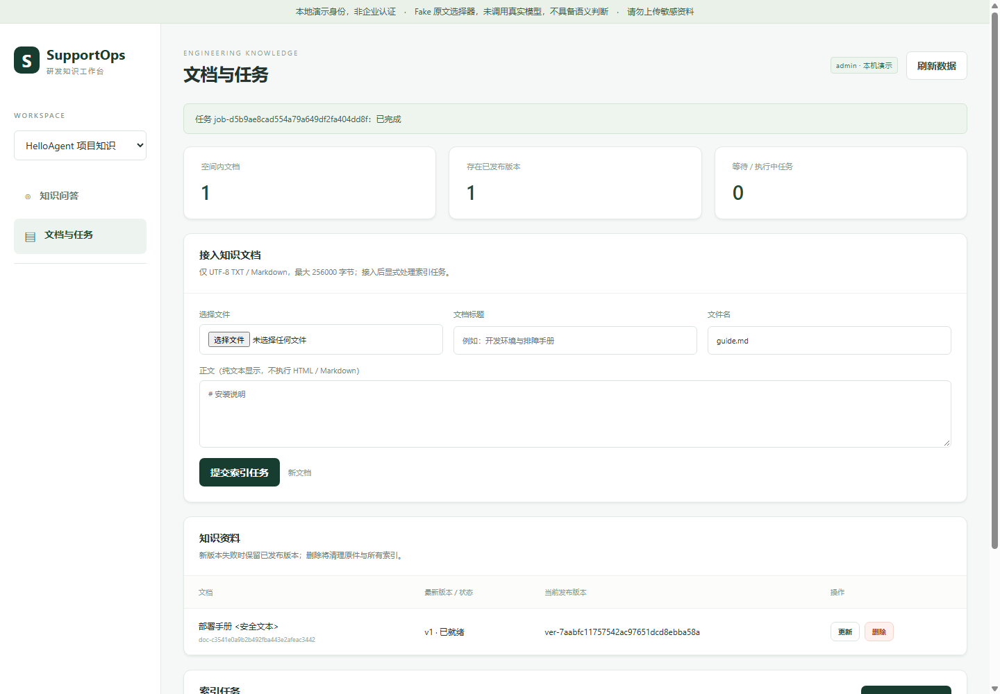

# SupportOps

研发知识与技术支持助手：把项目文档转为可检索、可引用、按空间隔离的知识工作台。
面向 AI 应用开发求职与技术演示，当前是**仅限本机的工程原型，不是可公开部署的生产服务**。

基于 Hello-Agents 教程学习实现并借助 AI 扩展框架，参考 Onyx 的知识工作台职责划分。
不宣称完全独立原创，也未引入 Onyx 客户数据。项目内容采用 [CC BY-NC-SA 4.0](LICENSE)，
保留上游署名与本地改写记录，第三方依赖保留各自许可；见 [第三方说明](THIRD_PARTY_NOTICES.md)。
GitHub：[kekevot233/supportops](https://github.com/kekevot233/supportops)。

## 能做什么

- 文档：MD/TXT 接入、持久化任务、失败重试、版本原子发布、删除与历史引用。
- 知识问答：空间权限、私有会话、原文证据、反馈和运行诊断；默认使用离线 Fake 选择器。
- 工程底座：统一 Agent/工具接口、记忆与 RAG、完整请求预算、失败不提交对话历史。
- 可复现评测：区分检索、回答质量、权限/事务和浏览器验收，不以单元测试代替模型质量。

```text
文档 → 标准化/章节切块 → Hashing Embedding → 向量召回/词项混合重排
                                                   ↓
空间与版本复核 ← 原文引用 ← 临时证据上下文/请求预算 → 回答 → 私有会话/反馈
```

应用默认用 SQLite 保存业务资料与索引，检索时装载内存向量；**没有默认接入 Qdrant/Neo4j**。
后两者是底层框架的可选适配器，已另做本机兼容性验证。

## 五分钟本机体验（无密钥）

要求 Python 3.10+，建议使用已验证的 Python 3.12。

```powershell
git clone https://github.com/kekevot233/supportops.git
cd supportops
python -m venv .venv
.\.venv\Scripts\Activate.ps1
python -m pip install -r requirements-ci.txt
python -m pip install -e .
$env:PYTHON_DOTENV_DISABLED='1'
$env:HELLO_AGENTS_RUN_REAL_STORES='0'
python -m supportops search "扫描版 PDF 为什么无法检索？"
python -m supportops evaluate --output outputs/supportops_baseline.json
```

Linux/macOS 激活环境用 `source .venv/bin/activate`；环境变量用
`export PYTHON_DOTENV_DISABLED=1 HELLO_AGENTS_RUN_REAL_STORES=0`。
首次启动网页前导入 10 份公开种子文档（每次 `work` 处理一个任务）：

```powershell
python -m supportops demo --enable-demo --profile admin init
python -m supportops demo --enable-demo --profile admin import-seed helloagent
1..10 | ForEach-Object { python -m supportops demo --enable-demo --profile admin work helloagent }
python -m supportops serve --enable-demo --profile admin --port 8765 --open-browser
```

Linux/macOS 可将循环替换为 `for i in $(seq 1 10); do python -m supportops demo --enable-demo --profile admin work helloagent; done`。
服务只监听 `127.0.0.1`；打开完整临时链接，不要分享、截图或转发其中的会话凭据。
网页仍为 `fake_extractive`，能验证引用流程，不能据此判断语义理解、拒答或抗注入能力。
运行时资料写入被忽略的 `outputs/`。SupportOps 需从仓库根目录运行，未包含在框架 wheel 中。



截图来自公开离线测试夹具，不含真实企业资料或启动凭据。

## 已验证结果与边界

| 范围 | 结果 | 不能推断什么 |
| --- | --- | --- |
| 公开检索开发集 | 25/25，Recall@5=1.0，MRR@5=0.94 | 不等于回答准确率 |
| 完整 Fake 回答开发集 | 20/32；拒答 0/5，污染 0/2 | 引用原文一致不等于结论有依据 |
| 授权 DeepSeek 三题试跑 | 3/3，同批 Fake 1/3 | 非盲测，不等于完整评测或生产验收 |
| 本机浏览器工程检查 | 13 组 | 不替代模型语义/安全评测 |

结果来自 10 份人工整理的公开项目文档；详见 [资料来源](data/supportops/README.md)、
[完整阶段与结果索引](docs/supportops/README.md)、[真实试跑记录](docs/supportops/P5_LIVE_PILOT.md)。
真实试跑仅用 Hashing；未调用在线 Embedding，费用估算不是供应商账单。

## 测试与发布

```powershell
# 日常改动按范围选择测试，不默认全量回归。
python -m unittest discover -p "test_supportops*.py" -v
python -m unittest test_release_preparation -v
python scripts/check_release.py --export
```

GitHub Actions 默认执行 SupportOps 与发布检查专项，完整回归仅手动选择；不配置模型密钥。
旧学习案例的全量回归需先安装 `requirements-legacy-test.txt`。
[发布检查说明](docs/RELEASING.md)、[贡献指南](CONTRIBUTING.md)、[安全边界](SECURITY.md)。
维护者已确认以 CC BY-NC-SA 4.0 公开项目内容；公开源码不代表可任意商用或生产部署。
发布检查是有限规则扫描，不是完整安全审计、法律合规认证或模型质量证明。

## 框架与学习案例

下面保留框架使用指南。仓库名 supportops 与 Python 包 `hello_agents`、分发名
`hello-agents-learning` 是不同层次，本次不做破坏性包重命名。

一个用于学习 Agent 工作原理的轻量级 Python 框架。项目从手写 Agent 循环出发，
逐步实现统一 LLM 适配器、消息与配置模型、Agent 抽象、工具系统、原生 Function
Calling，以及 ReAct、Reflection、Plan-and-Solve 等常见范式。

本仓库同时保留 AI 技术日报和 LangGraph 日报案例，用于展示框架之外的完整应用
数据流。框架代码位于 `hello_agents/`，根目录的早期脚本用于保留学习过程。

### SupportOps 阶段详情

面向 AI 应用开发求职，项目正演进为“研发知识与技术支持助手”，参考 Onyx 的知识工作台
职责划分，继续复用本仓库框架。当前完成需求、页面草图、10 份项目知识、30 个验收场景及
可运行的离线检索基线；P1 已增加持久化空间、成员角色与本机演示身份服务。
P2 已接入有界文本原件、持久化索引任务、版本发布/删除及空间隔离检索。
P3 已增加私有会话、严格抽取式引用回答、反馈、运行记录和可注入的 WSGI JSON API。
P4 已接通本机可视化工作台、随机会话凭据、文档/任务、问答/引用/反馈与运行详情，并通过真实
浏览器离线验收。当前使用明确标注的 Fake 原文选择器；生产认证、真实模型质量和常驻任务仍待实施。
P5a 新增独立回答评测和显式运行时：32 项 smoke 中 Fake 仅满足 20 项，拒答与污染检查未通过；
如实保留为真实模型对照基线，不将引用正确当作回答准确。
P5b 已实现 OpenAI-compatible SDK 适配、请求限额和独立用量回执，并通过纯离线 SDK/MockTransport
测试；修复同分证据的时间排序干扰。该阶段未调用真实服务。
P5c-1 新增无密钥的有限样本配置/摘要/请求预算预检，最多选择 3 题；检查通过不等于授权联网。
P5c-2 已在明确授权下完成 DeepSeek 三题真实试跑：3/3 通过、同批 Fake 1/3，已保存独立用量回执与
预算/故障记录。工作台仍为 Fake，不把三题结果当完整评测或生产准确率。

详见 [SupportOps 使用入口与实测结果](docs/supportops/README.md)、
[需求说明](docs/supportops/PRD.md) 和 [后续开发清单](docs/supportops/DESIGN.md)。
空间权限的实现与演示命令见 [P1 说明](docs/supportops/P1_WORKSPACES.md)。
文档接入、任务执行和版本检索见 [P2 说明](docs/supportops/P2_DOCUMENTS.md)。
私有会话、Fake 回答与 API 边界见 [P3 说明](docs/supportops/P3_CHAT_API.md)。
本机网页启动与浏览器验收见 [P4 工作台](docs/supportops/P4_WORKBENCH.md)。
回答质量、拒答与污染基线见 [P5a 评测](docs/supportops/P5_ANSWER_EVALUATION.md)。
SDK 适配、限额和真实联调边界见 [P5b 说明](docs/supportops/P5_SDK_ADAPTERS.md)。
无凭据配置与离线预检见 [P5c-1 说明](docs/supportops/P5_PREFLIGHT.md)。
受控真实调用、三题结果与费用边界见 [P5c-2 说明](docs/supportops/P5_LIVE_PILOT.md)。

启动工作台（只监听 127.0.0.1；打开终端输出的完整临时链接，勿分享）：

```powershell
cd supportops
$env:PYTHON_DOTENV_DISABLED='1'
python -m supportops serve --enable-demo --profile admin --port 8765 --open-browser
```

```powershell
python -m supportops search "扫描版 PDF 为什么无法检索？"
python -m supportops evaluate --output outputs/supportops_baseline.json
```

以上命令只做本地检索和原文引用，不调用 LLM；公开开发集的 25 / 25 检索通过不等于
生成答案准确率或应用上线验收通过。supportops 入口需从仓库运行，未打入框架 wheel。

## 已实现能力

- OpenAI-compatible Chat Completions 适配器。
- DeepSeek、OpenAI、ModelScope、智谱、Ollama、vLLM 和通用兼容地址识别。
- 普通文本、流式文本和原生 Function Calling。
- `Message`、`Config`、统一异常和 `Agent` 模板方法。
- `SimpleAgent` 文本工具协议与原生工具调用模式。
- `ReActAgent` 严格 Thought / Action / Observation / Finish 循环。
- `ReflectionAgent` 生成、反思、改写循环。
- `PlanAndSolveAgent` 严格 JSON 规划和顺序执行。
- `Tool`、`ToolParameter`、`ToolRegistry` 与 OpenAI 工具 Schema。
- 基于 AST 白名单的 `CalculatorTool`。
- 带预检、上下文隔离和模板安全限制的 `ToolChain`。
- 工作记忆、SQLite 情景记忆和向量 + 知识图谱混合语义记忆。
- 内存/Qdrant 向量存储与内存/Neo4j 图存储适配器。
- 基于 GSSC 的 `ContextBuilder`、结构化 `NoteTool` 与无 shell 的只读
  `TerminalTool`。
- Fake LLM、Fake SDK、Fake Search 与 Fake SMTP 离线测试。

## 安装

项目要求 Python 3.10 或更高版本。

```powershell
python -m pip install -e .
```

框架本身不会自动加载 `.env`。凭证必须由应用层通过环境变量或显式参数提供，
也可以在测试中注入假的 `environ` 和 SDK client。

## 快速开始

### 普通对话

```python
from hello_agents import HelloAgentsLLM, SimpleAgent

llm = HelloAgentsLLM()
agent = SimpleAgent(name="基础助手", llm=llm)

answer = agent.run("用一句话解释什么是 Agent")
print(answer)
```

这段代码会访问实际模型服务。运行前应确认模型配置、费用和网络权限。

### 原生 Function Calling

```python
from hello_agents import (
    CalculatorTool,
    HelloAgentsLLM,
    SimpleAgent,
    ToolRegistry,
)

registry = ToolRegistry()
registry.register_tool(CalculatorTool())

agent = SimpleAgent(
    name="计算助手",
    llm=HelloAgentsLLM(),
    tool_registry=registry,
    tool_call_mode="native",
)

answer = agent.run("计算 2 + 3 * 4")
print(answer)
```

`tool_call_mode="text"` 是兼容文本协议的默认模式；原生模式通过工具 Schema 和
`tool_call_id` 完成结构化调用。

### ReActAgent

```python
from hello_agents import CalculatorTool, HelloAgentsLLM, ReActAgent, ToolRegistry

registry = ToolRegistry()
registry.register_tool(CalculatorTool())

agent = ReActAgent(
    name="ReAct 助手",
    llm=HelloAgentsLLM(),
    tool_registry=registry,
)

answer = agent.run("先计算 2 + 3，再把结果乘以 4")
```

ReAct 工具 Action 使用严格 JSON：

```text
Thought: 需要先完成第一次计算。
Action: calculator:{"expression":"2 + 3"}
```

### ReflectionAgent

```python
from hello_agents import HelloAgentsLLM, ReflectionAgent

agent = ReflectionAgent(
    name="反思助手",
    llm=HelloAgentsLLM(),
    max_iterations=2,
)

answer = agent.run("写一段关于 AI Agent 的简介")
```

反思响应必须以唯一的状态行结束：

```text
STATUS: PASS
```

或：

```text
STATUS: NEEDS_IMPROVEMENT
```

### PlanAndSolveAgent

```python
from hello_agents import HelloAgentsLLM, PlanAndSolveAgent

agent = PlanAndSolveAgent(
    name="规划助手",
    llm=HelloAgentsLLM(),
)

answer = agent.run("分析一个复杂问题并给出分步结论")
```

规划器必须返回严格 JSON 字符串数组。计划长度在执行前完成校验，任何一步失败都
不会把不完整任务写入长期对话历史。

### ToolChain

```python
from hello_agents import ToolChain, ToolChainManager, ToolRegistry

registry = ToolRegistry()
registry.register_function(
    "uppercase",
    "转换为大写",
    lambda text: text.upper(),
    parameter_name="text",
)
registry.register_function(
    "decorate",
    "装饰文本",
    lambda text: f"<{text}>",
    parameter_name="text",
)

chain = ToolChain("format_text", "转换并装饰文本")
chain.add_step(
    "uppercase",
    {"text": "{input}"},
    output_key="upper",
)
chain.add_step(
    "decorate",
    {"text": "{upper}"},
    output_key="decorated",
)

manager = ToolChainManager(registry)
manager.register_chain(chain)
print(manager.execute_chain("format_text", "hello"))
```

工具链会在执行前检查工具、变量和输出键。模板只允许简单标识符占位符，不允许
属性、下标、转换或格式说明符。

## 工作记忆

第八章第一阶段实现了统一记忆接口和完全离线的进程内工作记忆：

```python
from hello_agents import MemoryManager, MemoryTool, ToolRegistry

manager = MemoryManager(user_id="demo-user")
manager.add_memory("用户偏好 Python", importance=0.8)

results = manager.retrieve_memories("编程偏好")
print(results[0].item.content)

registry = ToolRegistry()
registry.register_tool(MemoryTool(manager))
```

`WorkingMemory` 支持容量上限、TTL 自动过期、重要性过滤和访问计数。检索阶段先用
无需外部模型的 TF-IDF 与关键词覆盖率，再结合时效性和重要性排序。`MemoryManager`
负责按记忆类型路由，后续接入 Qdrant、Neo4j 或其他持久化后端时，Agent 和工具层
不需要改变调用方式。

## Embedding 抽象层

向量化组件通过 `BaseEmbedder` 与记忆后端解耦。默认的 `HashingEmbedder` 使用稳定
特征哈希，完全离线、无模型下载，适合作为开发和测试基线：

```python
from hello_agents import EmbeddingConfig, create_embedder

embedder = create_embedder(EmbeddingConfig(dimension=384))
vector = embedder.embed("用户偏好 Python")
```

已有本地 SentenceTransformer 模型时，可以使用延迟加载适配器：

```python
from hello_agents import EmbeddingConfig, create_embedder

config = EmbeddingConfig(
    provider="sentence_transformer",
    model_path=r"D:\models\text-embedding-model",
    dimension=384,
)
embedder = create_embedder(config)
```

本地适配器只接受本地路径，不会按远程模型名称自动下载。相关依赖为可选项：

```powershell
pip install ".[local-embeddings]"
```

`HashingEmbedder` 是词项哈希基线，不具备神经网络模型的语义理解能力。Qdrant 接入
后可继续使用同一接口替换为本地模型或云端 Embedding 适配器。

## 持久化情景记忆

`EpisodicMemory` 将完整正文和结构化字段保存在 SQLite，将向量和过滤 payload
交给 `BaseVectorStore`。离线开发可以使用精确扫描的 `InMemoryVectorStore`：

```python
from hello_agents import (
    EpisodicMemory,
    HashingEmbedder,
    InMemoryVectorStore,
    MemoryManager,
    SQLiteMemoryStore,
)

embedder = HashingEmbedder(384)
documents = SQLiteMemoryStore("data/episodic.sqlite3")
vectors = InMemoryVectorStore(384)
episodic = EpisodicMemory(
    document_store=documents,
    vector_store=vectors,
    embedder=embedder,
    user_id="demo-user",
)
manager = MemoryManager(
    user_id="demo-user",
    backends={"episodic": episodic},
)
manager.add_memory(
    "用户完成了第一个 Agent 项目",
    memory_type="episodic",
    importance=0.8,
)
```

生产或本地容器环境可将向量后端替换成 `QdrantVectorStore`。适配器使用当前官方
Python 客户端的 `query_points` 接口，但不会主动读取环境变量或在构造时联网：

```python
from hello_agents import QdrantVectorStore

vectors = QdrantVectorStore(
    collection_name="episodic_memory",
    dimension=384,
    url="http://localhost:6333",
)
```

安装可选客户端：

```powershell
pip install ".[vector-stores]"
```

添加情景记忆时先写 SQLite、再写向量后端；向量写入失败会回滚正文。检索按用户和
记忆类型过滤候选，然后使用“向量相似度 80% + 时间近因性 20%”并叠加重要性权重。

## 混合语义记忆

`SemanticMemory` 把一条知识同时保存到 SQLite 正文库、向量索引和知识图谱，并将
向量相关度与图关系相关度混合排序。离线开发可全部使用进程内后端：

```python
from hello_agents import (
    HashingEmbedder,
    InMemoryGraphStore,
    InMemoryVectorStore,
    MemoryManager,
    SemanticMemory,
    SQLiteMemoryStore,
)

embedder = HashingEmbedder(384)
semantic = SemanticMemory(
    document_store=SQLiteMemoryStore("data/semantic.sqlite3"),
    vector_store=InMemoryVectorStore(384),
    graph_store=InMemoryGraphStore(),
    embedder=embedder,
    user_id="demo-user",
)
manager = MemoryManager(
    user_id="demo-user",
    backends={"semantic": semantic},
)
manager.add_memory(
    "Python 可用于构建 Agent",
    memory_type="semantic",
    importance=0.9,
    metadata={
        "entities": [
            {"name": "Python", "type": "Technology"},
            {"name": "Agent", "type": "Concept"},
        ],
        "relations": [
            {"source": "Python", "target": "Agent", "type": "用于构建"}
        ],
    },
)
```

默认 `MetadataKnowledgeExtractor` 从 `metadata.entities` 和
`metadata.relations` 读取结构化知识，以保证离线、确定性和可测试。需要从自然语言
自动抽取时，可以显式注入 `LLMKnowledgeExtractor`：

```python
from hello_agents import LLMKnowledgeExtractor, SemanticMemory

extractor = LLMKnowledgeExtractor(
    llm,
    max_content_chars=20_000,
    max_entities=100,
    max_relations=200,
)
semantic = SemanticMemory(
    document_store=document_store,
    vector_store=vector_store,
    graph_store=graph_store,
    embedder=embedder,
    extractor=extractor,
    minimum_quality_score=0.9,
    user_id="demo-user",
)
```

LLM 接收的是带“不执行输入指令”声明的 JSON 数据，而不是可以自由改变系统行为的
提示词。响应必须是没有 Markdown 代码围栏、重复字段、未知字段或 `NaN` 的严格 JSON；
关系两端也必须显式出现在实体数组中。过长文本不会被静默截断，而是提示先切块。

无论使用哪种提取器，`KnowledgeGraphValidator` 都会在任何存储写入前检查重复实体、
重复关系、悬空端点、用户归属和来源记忆。错误会拒绝整条写入；自环等警告会降低质量
分，可通过 `minimum_quality_score` 决定是否接收。这样模型输出不会先写入 SQLite、
向量库或图数据库后才被发现有问题。

真实图后端可替换成 `Neo4jGraphStore`：

```python
from hello_agents import Neo4jGraphStore

graph = Neo4jGraphStore(
    uri="neo4j+s://your-instance.databases.neo4j.io",
    username="neo4j",
    password="由应用层安全注入的密码",
    database="neo4j",
)
```

安装可选驱动：

```powershell
pip install ".[graph-stores]"
```

Neo4j 适配器使用固定的 `MemoryEntity` 节点标签和 `RELATED` 关系类型，业务关系名保存在
参数化属性中，避免把外部文本拼进 Cypher。共享实体会合并来源记忆 ID；删除单条记忆
时，只有不再被其他记忆引用的孤立实体才会删除。混合评分公式为
`(向量分数 × 0.7 + 图分数 × 0.3) × (0.8 + 重要性 × 0.4)`。

## 感知记忆

`PerceptualMemory` 为不同模态配置独立的编码器和向量存储。这样文本、图像和音频模型
即使输出维度不同，也不会写入同一个集合：

```python
from hello_agents import (
    HashingEmbedder,
    InMemoryVectorStore,
    MemoryManager,
    MetadataModalityEncoder,
    PerceptualMemory,
    SQLiteMemoryStore,
    TextModalityEncoder,
)

text_embedder = HashingEmbedder(384)
image_metadata_embedder = HashingEmbedder(256)
perceptual = PerceptualMemory(
    document_store=SQLiteMemoryStore("data/perceptual.sqlite3"),
    encoders={
        "text": TextModalityEncoder(text_embedder),
        "image": MetadataModalityEncoder("image", image_metadata_embedder),
    },
    vector_stores={
        "text": InMemoryVectorStore(384),
        "image": InMemoryVectorStore(256),
    },
    user_id="demo-user",
)
manager = MemoryManager(
    user_id="demo-user",
    backends={"perceptual": perceptual},
)
manager.add_memory(
    "白板上的 Agent 系统架构",
    memory_type="perceptual",
    metadata={"raw_data": r"D:\materials\agent-whiteboard.png"},
)
```

扩展名只用于推断 `text`、`image`、`audio`、`video` 或 `file` 模态，不会因此打开
文件。`MetadataModalityEncoder` 只把描述文字和文件名编码为向量，是用于离线开发
和测试的元数据基线，不具备视觉或音频理解能力。需要读取真实媒体内容时，可使用
`LocalCLIPEncoder` 和 `LocalCLAPEncoder`：

```python
from hello_agents import LocalCLAPEncoder, LocalCLIPEncoder

clip = LocalCLIPEncoder(
    model_path=r"D:\models\clip",
    expected_dimension=512,
)
clap = LocalCLAPEncoder(
    model_path=r"D:\models\clap\music_audioset_epoch_15_esc_90.14.pt",
    expected_dimension=512,
)
```

CLIP 把图像与文本映射到同一空间，CLAP 把音频与文本映射到同一空间，因此都支持用
自然语言检索媒体。模型只允许从已存在的本地路径加载，也可以显式注入已加载模型；
框架不会根据模型名称自动下载。默认 CLAP 初始化还会临时强制模型库进入离线模式，
本地 tokenizer 缓存不完整时直接失败并恢复原环境；也可以注入自行初始化的模型工厂。
可选依赖可通过 `pip install ".[multimodal]"` 安装。

`MemoryTool` 的 `perceptual add` 支持 `file_path` 和可选 `modality`。提供文件路径时
可以省略 `content`，工具会使用文件名生成安全的描述文本。感知检索支持指定
`target_modality`，默认搜索所有已配置模态，评分公式为
`(向量分数 × 0.8 + 时间近因性 × 0.2) × (0.8 + 重要性 × 0.4)`。

## 记忆整合与遗忘

`MemoryManager` 提供统一生命周期入口。遗忘策略只负责选择候选，真正删除仍调用具体
后端的 `remove()`，因此情景、语义和感知记忆能够同步清理自己的向量或图索引：

```python
from hello_agents import ForgettingPolicy

removed = manager.forget_memories(
    ForgettingPolicy(
        strategy="smart",
        max_age_days=90,
        retention_threshold=0.35,
        max_removals=20,
    ),
    memory_types=["episodic", "semantic"],
)
```

支持四种策略：`importance` 删除低重要性记忆；`time` 删除超龄记忆；`capacity` 在超出
容量时删除保留分最低的记忆；`smart` 综合重要性、时间近因性和访问次数。策略先返回
确定性排序的候选，并可通过 `max_removals` 限制单次影响范围。

整合用于把高价值记忆从一个后端迁移到另一个后端：

```python
migrated = manager.consolidate_memories(
    source_type="working",
    target_type="episodic",
    min_importance=0.8,
    limit=10,
)
```

整合会先用新 ID 写入目标后端，再删除来源；若来源删除失败，会尝试删除刚写入的目标
记忆作为补偿。新记忆通过 `consolidated_from` 和 `consolidated_from_type` 保留来源。

需要跨进程恢复时，可以为管理器配置 SQLite 生命周期日志，并为业务请求提供稳定的
幂等键：

```python
from hello_agents import MemoryManager, SQLiteLifecycleStore

journal = SQLiteLifecycleStore("data/memory_lifecycle.sqlite3")
manager = MemoryManager(
    user_id="demo-user",
    backends=backends,
    lifecycle_store=journal,
)

migrated = manager.consolidate_memories(
    source_type="working",
    target_type="episodic",
    min_importance=0.8,
    idempotency_key="promote-session-2026-10-11",
)

# 进程重启后核对 pending、running 和 failed 任务的真实存储状态。
manager.reconcile_lifecycle_tasks(limit=100)
```

日志会记录任务请求、逐条检查点、结果和尝试次数。整合使用确定性的目标 ID，恢复时先
核验来源与目标的真实状态以及目标归属，再决定补写目标或删除来源；同一个幂等键重复
提交会返回原任务结果，不会再次迁移。遗忘任务也会持久化候选快照并支持重试。
`MemoryTool` 提供 `forget`、`consolidate`、`reconcile` 和 `lifecycle_status`，后两项只
返回数量与状态汇总，不公开记忆正文。

生命周期日志包含完整记忆快照，可能含敏感内容，数据库文件应采用与记忆正文数据库
相同的访问控制、备份和加密策略。该状态机提高了故障恢复能力，但仍不是跨
SQLite/Qdrant/Neo4j 的原子分布式事务；多进程并发执行还需要外部任务租约或分布式锁。

## 记忆增强 Agent（RAG 闭环）

`MemoryContextProvider` 在每次 Agent 运行开始时，根据当前问题检索
`MemoryManager`，并把有限长度的结果作为临时系统上下文注入模型：

```python
from hello_agents import MemoryContextProvider, MemoryManager, SimpleAgent

manager = MemoryManager(user_id="demo-user")
manager.add_memory("用户偏好使用 Python", importance=0.9)

agent = SimpleAgent(
    name="记忆助手",
    llm=llm,
    context_provider=MemoryContextProvider(manager),
)
answer = agent.run("用户偏好哪种编程语言？")
```

上下文提供器可限制记忆类型、最低重要性、条数、单条长度和总字符数。默认采用
fail-closed：检索失败时终止本轮，避免模型在缺少必要记忆时悄悄作答；也可以显式设置
`fail_open=True` 降级为无记忆回答。

检索内容使用 JSON 数据块包装，并明确标记为“不可信记忆数据”，降低持久化提示注入
被当作系统指令执行的风险。上下文只在当前 `run()` 或 `stream_run()` 中存在：工具循环、
ReAct、Reflection 和 Plan-and-Solve 的多次模型调用会复用同一份检索结果，但它不会
写入长期对话历史。由此形成完整数据流：

```text
用户问题 → 统一记忆检索 → 有界安全上下文 → Agent 推理/工具调用 → 最终回答
```

## 文档知识库与带引用 RAG

`DocumentKnowledgeBase` 将外部资料转换成可追溯知识块。内置加载器支持本地 UTF-8
纯文本、Markdown、PDF 和 DOCX：

```python
from hello_agents import (
    DocumentContextProvider,
    DocumentKnowledgeBase,
    HashingEmbedder,
    InMemoryVectorStore,
    LocalTextDocumentLoader,
    PDFDocumentLoader,
    SQLiteMemoryStore,
    SimpleAgent,
)

loader = LocalTextDocumentLoader()
document = loader.load("docs/guide.md")
# PDFDocumentLoader().load("docs/manual.pdf")
knowledge_base = DocumentKnowledgeBase(
    document_store=SQLiteMemoryStore("data/documents.sqlite3"),
    vector_store=InMemoryVectorStore(384),
    embedder=HashingEmbedder(384),
    user_id="demo-user",
)
knowledge_base.ingest(document)

agent = SimpleAgent(
    "文档助手",
    llm,
    context_provider=DocumentContextProvider(knowledge_base),
)
answer = agent.run("文档如何配置记忆？")
```

PDF 和 DOCX 使用可选依赖，基础安装不会自动增加包体积：

```powershell
pip install ".[document-loaders]"
```

`PDFDocumentLoader` 逐页提取文本并记录字符区间到页码的映射，支持显式提供加密 PDF
密码；没有文本层的扫描件会明确提示需要 OCR。`WordDocumentLoader` 支持 `.docx`，按照
正文原始顺序保留 Heading 1～6，并将表格转换为 Markdown。旧版二进制 `.doc` 不支持。

默认切块器按字符上限切分，并优先在段落、句号和空格处断开；相邻块保留重叠内容，
同时记录 Markdown 标题、块序号和原文字符区间。摄取后先进行向量召回，再由
`HybridReranker` 融合向量分数与中英文词项覆盖率重新排序。

查询结果同时返回 `[D1]`、`[D2]` 引用编号及文件路径、标题、章节、页码、块序号和
字符区间。`DocumentContextProvider` 会把正文与引用编码成有界 JSON，并明确标记为
不可信数据。文档更新使用版本化块 ID；新版本写入成功后才清理旧版本。

## 上下文工程（GSSC）

`ContextBuilder` 把记忆、文档、项目笔记和其他 `BaseContextProvider` 组合为统一的
 Gather → Select → Structure → Compress 流水线：

```python
from hello_agents import (
    ContextBuilder,
    ContextConfig,
    ExtractiveContextCompressor,
    DocumentContextProvider,
    MemoryContextProvider,
    NoteContextProvider,
    NoteTool,
    SimpleAgent,
)

notes = NoteTool("data/project_notes")
builder = ContextBuilder(
    config=ContextConfig(max_tokens=4000),
    compressor=ExtractiveContextCompressor(),
)
builder.add_provider("memory", MemoryContextProvider(manager), kind="memory")
builder.add_provider("documents", DocumentContextProvider(knowledge_base), kind="evidence")
builder.add_provider("notes", NoteContextProvider(notes), kind="note", priority=0.9)

agent = SimpleAgent(
    name="项目助手",
    llm=llm,
    context_provider=builder,
)
answer = agent.run("当前最重要的阻塞是什么？")
```

选择阶段综合相关性、新近性和来源优先级，在为模型输出预留空间后按 Token 预算选入
信息；结构化阶段分成规则、任务、证据、记忆/笔记、对话和工具上下文；超限时优先
压缩或移除低分外部资料，系统规则与当前任务不会被静默截断。默认压缩器从原文中
确定性抽取与查询相关的句子，不生成原文没有的信息；也可显式注入
`LLMContextCompressor`，但框架不会自行创建模型客户端或读取凭据。Token 统计默认采用
离线启发式估算，也可注入已加载的模型 tokenizer。`last_result` 会保留入选包、丢弃数、估算
Token、压缩方式、失败降级警告，以及信息密度、查询覆盖、预算利用率和来源多样性等
质量指标，便于调试和回归比较。

作为 Agent 的上下文提供器时，Builder 只注入外部资料，不重复 Agent 已经发送的系统
提示、历史和当前用户消息；一次运行中的工具循环和多阶段推理继续复用同一份结果。

### Token 计数与分来源预算

`BaseTokenCounter` 把计数规则与上下文选择逻辑分开。默认 `HeuristicTokenCounter`
保留原来的中英文估算；`TokenizerTokenCounter` 接受应用已经加载的、提供
`encode(text, **kwargs) -> 一维 Token ID 序列` 的 tokenizer：

```python
from hello_agents import ContextBuilder, ContextConfig, TokenizerTokenCounter

# loaded_tokenizer 由应用提前加载；此适配器只调用 encode()。
counter = TokenizerTokenCounter(
    loaded_tokenizer,
    name="local-model-tokenizer",
    encode_kwargs={"add_special_tokens": False},  # 按 tokenizer 的接口配置
)
builder = ContextBuilder(
    config=ContextConfig(
        max_tokens=4000,
        source_max_tokens={"documents": 1400, "memory": 700, "notes": 500},
    ),
    token_counter=counter,
)
```

计数器贯穿正文选择、压缩验证和最终完整文本计数；编码失败会明确报错。旧版
`ContextBuilder.estimate_tokens(text)` 仍是静态启发式函数；要使用所配置的 tokenizer，
请调用 `builder.count_tokens(text)`。诊断字段 `token_counter` 标明使用了哪种计数器。
适配器不下载词表、不加载模型，基础依赖没有增加。

`source_max_tokens` 按 `ContextPacket.source` 或 provider 注册名匹配，限制同一可选
来源所有入选正文的 Token 总和；0 表示禁用该来源，未配置的来源共享总预算。达到
配额后会继续考虑其他来源。配额是上限，不保证某个来源一定入选，未用完的配额也
不预占全局预算；系统规则与当前任务仍完整保留或明确报错。`source_usage` 返回每个
来源最终正文 Token 数、上限、入选条数与丢弃条数。

全局预算还包含 Builder 自己的标题、标签、安全声明和输出指令。来源正文统计不含
这些包装，因此不能直接把来源用量相加当作最终 Token 数。作为 Agent provider 时，
预算只覆盖 Builder 生成的临时参考文本；Agent 其他消息、聊天模板和原生工具 Schema
可通过下文的 `RequestBudgetManager` 统一复核并预留。

### Agent 完整请求预算

`RequestBudgetManager` 是可选的请求预算协调器。四种内置 Agent 的文本调用、原生工具
调用和 SimpleAgent 流式路径都在模型调用前经过它；工具循环、反思与计划执行的每个
阶段也都会重新检查，覆盖本轮不断增长的工具结果和中间草稿：

```python
from hello_agents import RequestBudgetConfig, RequestBudgetManager, SimpleAgent

budget = RequestBudgetManager(
    RequestBudgetConfig(
        context_window=8192,
        output_tokens=1024,
        safety_margin_tokens=256,
    ),
)
agent = SimpleAgent(
    name="预算助手",
    llm=llm,
    context_provider=builder,
    request_budget=budget,
)
answer = agent.run("当前项目下一步是什么？", max_tokens=800)
print(agent.last_budget_report)
```

可将同一个 `TokenizerTokenCounter` 同时注入 Builder 和预算协调器。协调器计数覆盖
消息角色、正文、assistant 工具调用及参数、tool_call_id、工具结果、原生工具 Schema、
显式请求选项，以及 LLM 对象公开的模型名/温度和当前调用的 stream/tool_choice 默认值。
文本工具说明和 ReAct Schema 已嵌在消息中，因此随消息一起计数。

判断条件为 `estimated_input_tokens + reserved_output_tokens + safety_margin_tokens <=
context_window`。输出预留优先使用本次调用的 `max_tokens`，其次使用 LLM 对象的
`max_tokens`，最后使用预算配置的 `output_tokens`；同一上限会传入实际模型调用。
启用预算时输出参数统一使用 `max_tokens`，不接受其他输出上限别名。

超限时按最旧到最新移除历史轮次，历史中的 user、assistant 和完整工具调用链作为一组
处理；仍超限则整块移除本轮临时检索资料，不截坏其中的 JSON 或引用结构。系统规则、
当前任务、本轮工具调用链和工具定义保持完整，仍无法容纳时在模型调用前抛出
`ContextEngineeringError`。裁剪只影响请求副本，原有长期历史和仅在成功时提交本轮的
规则保持不变；未配置 `request_budget` 时保留原有调用行为。

`last_budget_report` 返回最新成功预算检查的深拷贝，包含输入估算、输出预留、安全余量、
工具 Schema 用量和移除的历史轮次/消息/上下文数量，不保存正文。下一次预算检查失败
会清除旧报告。流式调用结束或关闭时也会清理临时上下文引用。

计数采用紧凑 JSON 载荷加可配置的逐消息/请求开销，具体服务的隐藏聊天模板仍需应用
校准安全余量，尚未用真实供应商 usage 做误差评估。超长工具结果当前会阻止下一次模型
调用；此前已经执行的工具副作用不会回滚，也不会自动重放工具。

### 离线上下文质量基准

```powershell
D:\conda-envs\helloagent\python.exe run_context_benchmark.py --output outputs\context_benchmark.json
```

`benchmarks/context_cases.json` 包含六个固定案例，覆盖英文相关性筛选、中文知识检索、
长文中部事实保留、多来源预算竞争、同来源累计配额和无相关证据。运行器关闭时间
评分，使结果可重复；输出 JSON 检查全局/来源预算、期望来源、关键事实片段与查询
覆盖，任一案例失败时退出码为 1，可用于回归或 CI。

`ContextQualityEvaluator` 的分数是词项与来源统计形成的启发式诊断；基准另外校验
人工标注的原文片段是否保留。六个案例通过只说明这些固定场景符合预期，尚不能代表
真实 LLM 摘要忠实度或最终回答准确率。

## 结构化项目笔记

`NoteTool` 支持 `create/read/update/search/list/summary/delete`，用于记录 `task_state`、
`conclusion`、`blocker`、`action`、`reference` 和普通笔记。每条笔记是独立 Markdown
文件，前置元数据使用 JSON 对象——它同时是合法的 YAML 1.2 子集，因此不需要增加
PyYAML 依赖：

```python
from hello_agents import NoteTool, ToolRegistry

notes = NoteTool("data/project_notes")
record = notes.create_note(
    "第九章进度",
    "已完成 ContextBuilder，下一步验证长期任务恢复。",
    note_type="task_state",
    tags=["chapter-9", "context"],
)

registry = ToolRegistry()
registry.register_tool(notes)
```

索引与笔记采用同目录临时文件加 `os.replace()` 原子替换；更新失败会恢复旧内容，删除
必须显式 `confirm=true`，并移动到 `.trash` 而不是永久删除。`NoteContextProvider` 会
按当前问题检索笔记，以有界 JSON 和不可信数据声明注入 `ContextBuilder`。

## 长程任务检查点

`TaskCheckpointStore` 在 `NoteTool` 之上保存可验证的任务状态，使长任务在进程退出后
仍能知道目标、已完成步骤、当前步骤、待办、阻塞、决策和产物。恢复只生成下一步计划，
不会自动执行外部操作：

```python
from hello_agents import NoteTool, TaskCheckpointStore

store = TaskCheckpointStore(NoteTool("data/project_notes"))
checkpoint = store.create(
    "chapter9-upgrade",
    "完成上下文工程升级",
    steps=["实现压缩器", "运行回归", "更新文档"],
)

# 每次写入都带期望版本，旧副本不能覆盖新状态。
checkpoint = store.mark_current_step_completed(
    checkpoint.task_id,
    expected_version=checkpoint.version,
)
plan = store.plan_resume(checkpoint.task_id)
print(plan.next_step, plan.can_resume)
```

检查点正文使用严格 JSON 信封和 SHA-256 摘要；重复键、摘要不一致、非法状态跳转和
旧版本写入都会被拒绝。它依赖 `NoteTool` 的原子文件替换，适合单进程或由上层串行化
写入的本地任务；当前不提供跨进程文件锁或分布式租约。

## 即时只读文件探索

`TerminalTool` 用于 JIT（按需）查看代码库，而不是把全部文件预先塞进上下文：

```python
from hello_agents import TerminalTool

terminal = TerminalTool(r"D:\code\Hello-agent")
print(terminal.run({"command": "tree hello_agents 2"}))
print(terminal.run({"command": "grep ContextBuilder hello_agents *.py"}))
```

它不是系统 shell：实现不会调用 `shell=True`，也不会启动任意可执行程序。当前只支持
`pwd/cd/ls/tree/cat/head/tail/find/grep/wc/stat`，拒绝管道、重定向、命令替换和写
操作；所有路径经 `resolve()` 后必须仍位于工作区，且默认屏蔽 `.env`、私钥和常见凭据
文件。文件大小、遍历深度、条目数、匹配数和输出长度均有上限。

## 事务式历史提交

所有框架 Agent 都遵守同一原则：只有完整成功后，才把原始用户输入和最终回答
写入长期历史。模型异常、格式错误、工具失败或循环超限不会留下半成品历史。

ReAct 的 Thought、工具 Observation、Reflection 的反馈和 Plan-and-Solve 的中间
步骤都只保存在单次运行的临时上下文中。

## 离线测试

```powershell
$env:PYTHON_DOTENV_DISABLED='1'
D:\conda-envs\helloagent\python.exe -m unittest discover -p "test_*.py" -v
```

离线测试不需要 API Key，并且不会调用真实搜索、模型或 SMTP 服务。真实存储集成测试
也会被自动发现，但在没有显式开关时只显示为跳过，不会尝试连接数据库。

## Qdrant 与 Neo4j 真实兼容性测试

`test_real_stores.py` 是显式启用的集成测试，覆盖 Qdrant 写入、payload 过滤、检索、
删除和清空，Neo4j 实体/关系写入、共享实体、用户隔离、检索和删除，以及
`EpisodicMemory`、`SemanticMemory` 的真实后端端到端链路。

先启动只绑定本机的测试实例，再在当前 PowerShell 会话中设置变量并运行：

```powershell
$env:HELLO_AGENTS_RUN_REAL_STORES='1'
$env:HELLO_AGENTS_TEST_QDRANT_URL='http://127.0.0.1:6333'
$env:HELLO_AGENTS_TEST_NEO4J_URI='neo4j://127.0.0.1:7687'
$env:HELLO_AGENTS_TEST_NEO4J_USERNAME='neo4j'
$env:HELLO_AGENTS_TEST_NEO4J_PASSWORD='<临时测试密码>'
D:\conda-envs\helloagent\python.exe -m unittest test_real_stores.py -v
```

密码只应放在当前进程环境或专用密钥管理器中，不要提交到仓库。2026-10-12 已实际验证
Qdrant Server 1.19.2 + `qdrant-client` 1.19.1，以及 Neo4j Community 2026.09.0 +
Python Driver 6.4.0；四项真实测试全部通过，测试集合和节点均已清理。

## 目录结构

```text
hello_agents/
├── context/
│   ├── builder.py
│   └── models.py
├── core/
│   ├── agent.py
│   ├── config.py
│   ├── context.py
│   ├── exceptions.py
│   ├── llm.py
│   └── message.py
├── agents/
│   ├── simple_agent.py
│   ├── react_agent.py
│   ├── reflection_agent.py
│   └── plan_and_solve_agent.py
├── embeddings/
│   ├── base.py
│   ├── config.py
│   ├── factory.py
│   ├── hashing.py
│   └── sentence_transformer.py
├── memory/
│   ├── base.py
│   ├── context.py
│   ├── extractors.py
│   ├── lifecycle.py
│   ├── modalities.py
│   ├── manager.py
│   ├── stores/
│   │   └── sqlite.py
│   └── types/
│       ├── episodic.py
│       ├── perceptual.py
│       ├── semantic.py
│       └── working.py
├── graph_stores/
│   ├── base.py
│   ├── memory.py
│   └── neo4j.py
├── vector_stores/
│   ├── base.py
│   ├── memory.py
│   └── qdrant.py
├── rag/
│   ├── chunking.py
│   ├── context.py
│   ├── knowledge_base.py
│   ├── loaders.py
│   ├── models.py
│   └── rerankers.py
└── tools/
    ├── base.py
    ├── registry.py
    ├── chain.py
    └── builtin/
        ├── calculator.py
        ├── memory.py
        ├── note.py
        └── terminal.py
```

## 安全边界

- `CalculatorTool` 使用 AST 白名单，不使用 `eval()`。
- 工具参数经过 JSON 类型、必填字段和未知字段校验。
- LLM 和工具异常转换为框架异常，公开消息不包含底层 SDK 详情。
- 工具调用和规划都有明确次数或长度上限。
- `TerminalTool` 不启动 shell，只允许工作区内的有界只读文件操作，并屏蔽常见敏感文件。
- 外部记忆、文档和笔记都按不可信数据包装；系统规则不会因压缩被静默删除。
- 库代码不负责加载 `.env`，也不公开保存 API Key。
- 真实日报运行会访问外部服务，并可能发送邮件；不要把离线测试命令替换成真实入口。

## 当前限制

- 流式工具调用尚未实现；`stream_run()` 仍是纯文本流式对话。
- Checkpointer 使用内存存储，不提供跨进程恢复。
- 工作记忆只在当前 Python 进程中有效；情景正文可持久化，但内存向量后端不会
  跨进程恢复，真实持久向量检索需要配置 Qdrant。
- Embedding 已接入情景记忆；默认特征哈希仍不等同于语义模型。
- Qdrant 与 Neo4j 已通过本机单节点真实兼容性测试，但尚未验证云服务、TLS、认证轮换、
  高可用集群、网络中断恢复和大规模压力；自然语言知识抽取效果仍取决于所注入模型，
  不等同于可靠的多跳推理或人工校审。
- 感知记忆已提供本地 CLIP/CLAP 适配器，但尚未使用真实模型文件进行兼容性和检索
  质量评估；视频内容理解仍未实现。
- 记忆整合与遗忘已具备 SQLite 幂等日志和人工/工具触发的自动对账，但仍不是跨存储
  原子分布式事务，也未提供多进程任务租约或分布式锁。
- 文档 RAG 已实现文本、Markdown、PDF 和 DOCX 加载、切块、摄取、混合重排和引用；
  尚未实现扫描件 OCR、旧版 `.doc`、复杂 PDF 版面还原和模型式重排。
- `ContextBuilder` 支持默认离线估算和已加载 tokenizer 适配，但尚未验证具体供应商
  tokenizer 的真实词表；Agent 完整请求已有预算复核，但隐藏聊天模板的开销仍依赖
  可配置余量，尚未根据真实 usage 校准。超长本轮工具结果当前直接报错；可选 LLM
  压缩器只接受应用层注入的客户端，尚未用真实模型系统评估摘要忠实度。`NoteTool`
  的内置搜索仍是确定性词项匹配，任务检查点也不提供跨进程锁或分布式调度。
- `TerminalTool` 有意不提供 shell、管道、Git 写操作和任意程序执行；需要修改代码时
  应由具备独立审批与补丁审查的执行层完成。
- GitHub 项目筛选尚未记录 Star 增长历史。
- Windows 定时任务仍使用稳定版 `run_daily_brief.py`。
- 发布代码前必须确认 `.env` 没有被 Git 跟踪。

## 项目总结

更完整的架构说明、测试策略和简历描述见
[`PROJECT_SUMMARY.md`](PROJECT_SUMMARY.md)。
